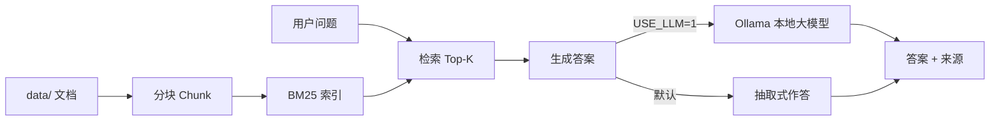

# 📚 llm-rag-kb · 本地知识库问答系统（RAG）

> 一个**完全可本地运行**的知识库问答系统：自研 BM25 检索 + 抽取式/大模型生成。
> 演示模式**零依赖**即可跑；开启 `USE_LLM=1` 后调用本地 Ollama 做真正的检索增强生成（RAG），数据不出本机。

[](https://www.python.org)
[](LICENSE)
[](https://docs.python.org/3/library/)

## ✨ 特性
- 🟢 **零依赖即可用**：检索（BM25）与抽取式生成均只用 Python 标准库
- 🧠 **真·RAG（可选）**：`USE_LLM=1` 时，检索上下文 → 本地 Ollama 生成答案，缓解大模型幻觉
- 📁 **私有知识**：把自己的文档丢进 `data/`，自动分块索引，数据不出本机
- 💬 **双入口**：Web 对话界面 + 命令行
- 🔧 **可替换**：检索层接口清晰，可平滑替换为 Chroma / FAISS；生成层可换任意 LLM

## 🏗️ 架构



## 📂 目录结构
```
llm-rag-kb/
├── run.py                 # 启动入口（serve / ask）
├── app.py                 # HTTP 服务 + CLI
├── rag/
│   ├── retriever.py       # BM25 检索（中文按字/英文按词）
│   ├── corpus.py          # 语料加载与分块
│   └── generator.py       # 答案生成（抽取式 / LLM）
├── data/
│   └── sample_corpus.md   # 示例语料（物联网/嵌入式 FAQ）
└── dashboard/
    └── chat.html          # 对话界面
```

## 🚀 快速开始

### 1）零依赖 Demo（推荐先跑）
```bash
python run.py
# 打开 http://localhost:8002/  开始对话
# 或命令行：
python run.py ask "什么是 MQTT？"
```

### 2）启用本地大模型（RAG 生成）
```bash
ollama pull qwen2.5:1.5b
USE_LLM=1 OLLAMA_MODEL=qwen2.5:1.5b python run.py
```

### 3）加入你自己的知识
把 `.md` / `.txt` 笔记放进 `data/`，重启即可被检索；也可设 `RAG_DATA` 指向任意目录。

常用环境变量：`RAG_PORT`（默认 8002）、`RAG_DATA`（语料目录）、`USE_LLM`、`OLLAMA_URL`、`OLLAMA_MODEL`。

## 🔍 技术要点
- **检索**：自研 BM25，中文按单字、英文/数字按词切分，无需分词器
- **分块**：按段落切分，长段滑动窗口重叠，兼顾召回与精度
- **生成**：默认抽取式（挑出与问题相关的句子，零依赖）；开启后用检索上下文约束大模型作答，降低幻觉

## 🗺️ 路线图
- [ ] 增加向量检索（Chroma/FAISS）作为 BM25 的可选后端
- [ ] 支持 PDF / Word 文档导入
- [ ] 对话历史与多轮追问

## 📄 License
[MIT](LICENSE) © 2026 Wooji
